<picture>
  <source media="(prefers-color-scheme: dark)" srcset="./assets/source-dark.svg" />
  
</picture>

I write SQL, Python, and dbt. I've built claims analytics pipelines at Cigna, manufacturing dashboards at Dr. Reddy's, and lending metrics at Bajaj Finserv—processing millions of records. I'm finishing a master's in Computer Science at Auburn and looking for my next full-time Data Analyst or BI Analyst role.

```ts
const samreen: Engineer = {
  name: "Samreen Mohammed",
  role: "Data Analyst Trainee at Bajaj Finserv",
  company: "Cigna Healthcare",
  location: "Alpharetta, Georgia, United States",
  yearsShipping: 5,
  languages: ["SQL", "Python", "HTML", "Jupyter Notebook", "TypeScript", "PLpgSQL"],
  stack: ["Scikit-learn", "Pandas", "NumPy", "dbt", "Excel", "Power BI", "Tableau", "Salesforce"],
  focus: "Healthcare claims analytics in Snowflake and AWS, processing 8M+ records",
  career: [
    { at: "Cigna Healthcare", role: "Data Analyst", when: "Jan 2025 – Feb 2026" },
    { at: "Dr. Reddy's Laboratories", role: "Junior Data Analyst", when: "Jan 2022 – Nov 2023" },
    { at: "Bajaj Finserv", role: "Data Analyst Trainee", when: "Jan 2021 – Dec 2021" },
  ],
  education: "Master of Science in Computer Science, Auburn University at Montgomery",
};
```

## `projects.map(explain)`

<details>
<summary><code>projects.fieldOpsSqlCostAudit()</code> Tested analytical SQL computing cost-to-serve and SLA-breach rates, surfaced in live Tableau dashboards</summary>

- SQL codebase that calculates technician utilization and cost-to-serve metrics
- Delivered in Tableau dashboards
- Stack: SQL, dbt, PostgreSQL, Tableau, Python, Docker

</details>

<details>
<summary><code>projects.retailMarginCockpit()</code> Governed retail margin and inventory analytics with row-level security, CI-verified on DuckDB</summary>

- dbt star schema feeding a DAX and Power BI semantic model
- Row-level security enforced in the semantic layer
- Stack: dbt, DuckDB, PostgreSQL, Power BI, DAX, Python, Docker

</details>

<details>
<summary><code>projects.eltPipelineDbtSnowflakeAirflow()</code> Production ELT pipeline extracting from public APIs, loading into Snowflake, and transforming with dbt</summary>

- Extracts data from Reddit, OpenWeather, and a SaaS PostgreSQL database
- Full testing, documentation, and lineage in dbt
- Stack: Python, Snowflake, dbt, Airflow, Docker

</details>

<details>
<summary><code>projects.lakehouseQualityGate()</code> Active data-quality gate that fails the pipeline on schema drift or null-floods before bad data reaches trusted marts</summary>

- dbt plus Great Expectations checkpoint emitting webhook alerts
- Prevents bad data from reaching downstream reporting
- Stack: Python, dbt, Great Expectations, DuckDB, Apache Airflow, GitHub Actions, Docker

</details>

<details>
<summary><code>projects.healthcareAnalytics()</code> AI-powered predictive analytics dashboard identifying high-risk patients before discharge</summary>

- Reduces 30-day hospital readmissions by **25%**
- Stack: Python, TypeScript, CSS, JavaScript, Docker

</details>

<details>
<summary><code>projects.weatherDataPipelineGreatExpectations()</code> Production weather data pipeline collecting hourly observations from 50+ global cities</summary>

- Validates every batch with Great Expectations and transforms data through dbt
- Stack: Python, dbt, Great Expectations, BigQuery, Docker

</details>

## `CHANGELOG.md`

### v3.0 · Cigna Healthcare

*January 2025 – February 2026*

- Built claims-based data extracts and healthcare analytics pipelines in Snowflake and AWS, processing over **8M+ records** annually to support operational reporting and KPI monitoring
- Automated recurring reporting and reconciliation workflows using SQL, Python, and dbt, reducing manual reporting preparation effort by approximately **35%**
- Developed performance measures and cohort analysis models using SQL and Python to identify utilization trends and claims-based patterns

### v2.0 · Dr. Reddy's Laboratories

*January 2022 – November 2023*

- Developed Tableau and Power BI dashboards for production and compliance stakeholders to monitor batch-processing efficiency and operational KPIs
- Translated business specifications into analytical SQL logic and reusable validation queries, reducing recurring metric discrepancies by approximately **25%**
- Built Python-based ETL utilities for data transformation and pipeline automation, reducing manual reporting effort by approximately **30%**

### v1.0 · Bajaj Finserv

*January 2021 – December 2021*

- Performed SQL-based data extraction and analysis on customer, lending, and transactional datasets containing over **2M+ records** to support repayment analytics and KPI reporting
- Developed Tableau and Power BI dashboards tracking repayment behavior, delinquency trends, and lending performance benchmarks
- Maintained reporting documentation, KPI definitions, and data-governance records while collaborating with analytics and operations teams

## `npm ls --depth=0`

<p align="center">
  
</p>

## `contact()`

[`linkedin`](https://www.linkedin.com/in/samreen-mohammed-658925273?jobid=1234&lipi=urn%3Ali%3Apage%3Ad_jobs_easyapply_pdfgenresume%3BSx2NXmL%2BSRms%2BrxmRTdBSQ%3D%3D&licu=urn%3Ali%3Acontrol%3Ad_jobs_easyapply_pdfgenresume-v02_profile) · [`github`](https://github.com/smoham37)

## Projects

- [field-ops-sql-cost-audit](https://github.com/smoham37/field-ops-sql-cost-audit) — A tested, layered analytical-SQL codebase computing cost-to-serve, technician utilization, and SLA-breach rates over messy field-ops data, surfaced in live…
- [retail-margin-cockpit](https://github.com/smoham37/retail-margin-cockpit) — Governed retail margin and inventory analytics: a tested dbt star schema feeding a DAX and Power BI semantic model with row-level security, CI-verified on…
- [elt-pipeline-dbt-snowflake-airflow](https://github.com/smoham37/elt-pipeline-dbt-snowflake-airflow) — A production-grade ELT pipeline that extracts data from multiple public APIs (Reddit, OpenWeather, and a SaaS PostgreSQL database), loads raw data into…
- [multi-source-marketing-analytics](https://github.com/smoham37/multi-source-marketing-analytics)
- [lakehouse-quality-gate](https://github.com/smoham37/lakehouse-quality-gate) — An active data-quality gate: a dbt plus Great Expectations checkpoint that fails the pipeline and emits a webhook alert on schema drift or null-floods before…
- [healthcare-analytics](https://github.com/smoham37/healthcare-analytics) — AI-powered predictive analytics dashboard that identifies high-risk patients before discharge, reducing 30-day hospital readmissions by 25%.
- [spotify-listening-analytics](https://github.com/smoham37/spotify-listening-analytics) — A full-stack data engineering platform that extracts personal Spotify listening history, playlist data, and audio features via OAuth 2.0, builds a dimensional…
- [ecommerce-lakehouse-medallion](https://github.com/smoham37/ecommerce-lakehouse-medallion)
- [weather-data-pipeline-great-expectations](https://github.com/smoham37/weather-data-pipeline-great-expectations) — A production-grade weather data pipeline that collects hourly observations from 50+ global cities via the Open-Meteo API, validates every batch with Great…
- [enhanced-anomaly-detection-system](https://github.com/smoham37/enhanced-anomaly-detection-system)
